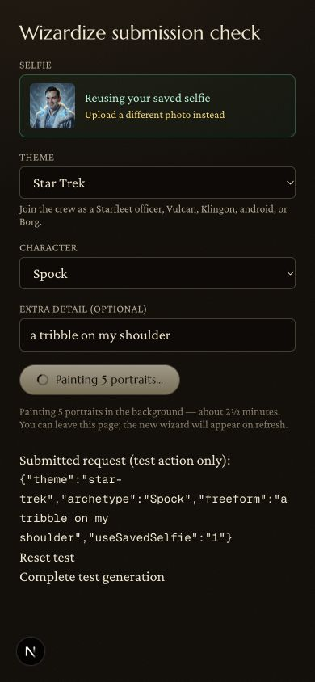

# Preserve Wizardize submission values

React resets uncontrolled form fields after a function action succeeds. Wizardize's action returns when background generation starts, so the character reverted to its initial option and extra detail cleared while the job was still running. The request itself retained the correct submitted values.

The form now cancels the reset event, preserving theme, character, extra detail, and selected photo while the job runs and after it completes. Theme changes still explicitly remount the character selector with a valid choice. Removed the redundant `encType`; React sets it for function actions.

## Browser regression check

Used a temporary development route rendering a copy of the actual form with only its action import replaced. A local Server Action captured the submitted FormData in a test cookie and revalidated the route. No generation service or database was called. The fixture was removed afterward.

- Before the fix: Enter submitted Star Trek / Spock / "a tribble on my shoulder", but the disabled form showed Picard and blank extra detail after the action returned.
- After the fix: Enter preserved Spock and the extra detail during generation and the form's four-second refresh polling.
- Simulated completion re-enabled the form with the submitted values intact.
- Switching to Lord of the Rings chose a valid initial character; selecting elf and submitting with the button retained the theme, elf, and "a silver circlet".
- Uploading `scripts/fixtures/test-selfie.jpg` retained the selected filename during generation.

